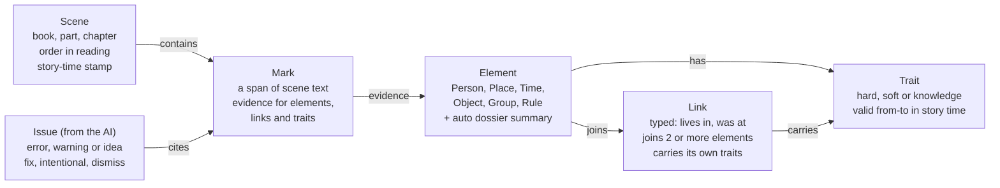
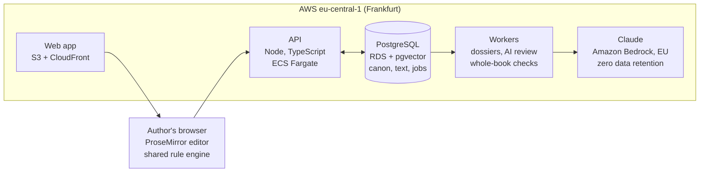

# Annotated Fiction Workbench: Rough Spec

5 November 2026 · Götz Neumann

## Vision

An online writing environment for novels in which the story world is a structured, queryable model, built up as you write. You mark passages with the people, places, times and rules they involve. Every marked passage feeds a living dossier for each entity, and an AI checks the manuscript against that model to flag contradictions and suggest ideas.

- **For:** novelists with complex casts, timelines or worldbuilding (fantasy, thrillers, sagas, series).
- **Twist:** annotation is typed and linked, not free-form margin notes. The book becomes a world graph.
- **Promise:** "Your story remembers everything. It tells you when you break your own rules."

## Naming: Story Elements and Traits

Decision: the things are called **Story Elements** (short: *elements*) and the whole model the **Story World**. "Dimensions" suggests axes of measurement rather than characters and places, and it collides with "dimension" as a sci-fi plot term.

| Option | Feels like | Downside |
| --- | --- | --- |
| Story Elements (chosen) | Plain, writer-friendly | A little generic |
| Lore / Lore entries | Fantasy wikis, game writing | Odd for literary or crime fiction |
| Codex entries | Scrivener-like reference book | Sounds static, not linked |
| Canon | The "truth" the AI checks against | Better as the name for confirmed facts |
| Dimensions | Abstract, technical | Reads as math or sci-fi |

Vocabulary used throughout the product and this spec:

- **Element:** a Person, Place, Time, Object, Group or Rule.
- **Trait:** formerly "constraint": a property that limits or enables (fear of heights, locked, forgotten).
- **Link:** a typed relation between elements (lives in, was at, owns, loves).
- **Mark:** an annotation on a span of text.
- **Canon:** the set of facts the AI treats as true.

## Core concepts

The model has five building blocks: elements, traits, links, marks and story time. The key idea is that facts are true *for a span of story time*, not forever.

**Element types (v1)**

| Type | Examples | Typical traits |
| --- | --- | --- |
| Person | Mara, the ferryman | Fear of heights, can't swim, blind, age 34, dead |
| Place | Lighthouse, Vienna | Far away, locked, underwater, burned down |
| Time | "The winter of the flood", 12 March 1921 | Past, forgotten, secret, disputed |
| Object | The brass key, a letter | Lost, broken, hidden, in possession of X |
| Group | The guild, a family | Disbanded, at war with Y |
| Rule | "Magic costs memory" | World-wide law the AI must enforce |

**Traits** have a kind and a strength:

- **Hard:** cannot be violated without an explanation (can't breathe underwater).
- **Soft:** violating it is a story beat, not an error (fear of heights, so climbing needs a reason).
- **Knowledge:** who knows a fact (Mara does not know the letter exists).
- Each trait has a validity window: from when to when in story time, or "always".

**Links** are typed and can join more than two elements. "Mara *was at* the Lighthouse *during* the Flood" is one link with three participants. Links can carry their own traits ("secretly", "against her will").

**Marks** attach a span of manuscript text to one or more elements, links or traits. A mark is the evidence; the element is the conclusion. Every fact in the model should point back to at least one mark, or be flagged as "author note, not yet in text".

**Story time vs. reading order.** Each scene has a position in story time, which may differ from its order in the book (flashbacks, parallel threads). Contradiction checks run in story time; reveal and foreshadowing checks run in reading order.

## Data model sketch

The model is a graph: scenes contain marks, marks are evidence for elements, and elements carry traits and join through links. AI issues always point back to the marks involved.

Storage idea: a relational core (Postgres) for scenes, marks and issues, with elements, links and traits as a graph layer on top. Mark offsets must survive edits, so the editor should use stable text anchors (as in collaborative editors), not character positions.

## Editor and annotation UX

Writing stays first: annotation must never interrupt drafting. The layout has three panes: manuscript tree on the left, editor in the middle, World panel on the right.

1. **Manuscript tree:** Book → Part → Chapter → Scene. Each scene has a story-time stamp (exact, approximate or relative: "two days after the Flood").
2. **Editor:** distraction-free prose. Marks show as subtle colored underlines by element type. Hover shows the element card; a toggle hides all marks.
3. **Making a mark:** select text, then type `@` (person), `#` (place), `~` (time), `!` (trait) or `/` (anything). Autocomplete existing elements, or create one inline.
4. **Implicit marks:** the AI proposes marks for names and pronouns it recognizes ("she" → Mara). They show as dotted suggestions, accepted with one key.
5. **Linking:** select a mark and drag it onto another, or use a sentence form: *[Mara] [is afraid of] [heights]*.
6. **World panel:** for the current scene, it shows who is present, where, when, which traits apply, and open issues.
7. **Views beyond the text:** an element dossier page, a relationship graph, a timeline per person and place, and a "where is everyone" map per story time.

## Summaries: from marks to dossiers

Every element gets an auto-maintained dossier, rebuilt incrementally whenever a marked passage changes. Each sentence in a dossier cites the marks it came from, so the author can jump back to the text.

A dossier has these parts:

- **Summary:** 3–5 sentences on who or what this is, as of the latest scene.
- **Facts and traits:** a table of each fact, its validity window in story time, and its source marks.
- **Arc:** how the element changes across the book ("Mara: afraid of heights → climbs the lighthouse in ch. 14").
- **Appearances:** scenes in reading order and in story-time order.
- **Links:** related elements, grouped by link type.
- **State at time T:** a time slider that shows the element as it is at any story moment.

There are summaries at other levels too: per scene (who, where, when, what changed), per chapter, and a whole-book "story so far" usable as a series bible.

Author notes (facts not yet in the text) appear in dossiers marked as *planned*, so the author can see what the book has not yet established.

## AI: contradictions and suggestions

The AI works in two layers. A deterministic rule engine checks the structured model cheaply and exactly. An LLM reads the prose to find what was never marked, then explains issues and suggests fixes. The AI never edits the manuscript on its own.

**Contradiction checks**

| Check | Example |
| --- | --- |
| Hard trait broken | Mara, who can't swim, crosses the river with no boat |
| Soft trait ignored | Mara climbs the tower with no hesitation, despite her fear of heights |
| Two places at once | Jon is in Vienna and at the lighthouse on the same night |
| Travel time | A place marked "far away" is reached in one scene with no time passing |
| Access | A character enters a room that is locked, with no key in their possession |
| Knowledge leak | A character refers to a secret before learning it |
| Dead or absent | A dead character speaks; a lost object is used |
| Timeline | Ages, dates or seasons that don't add up |
| Rule broken | Magic is used without its stated cost |
| Drift | Eye color, names or titles change between chapters |

**Suggestions**

- **Unmarked mentions:** "Chapter 7 mentions the lighthouse 4 times without a mark."
- **Unused setups:** a trait or object established but never paid off (Chekhov's gun).
- **Opportunities:** "Mara's fear of heights could raise the stakes in the tower scene."
- **Gaps:** a character missing from the story for 9 chapters; a timeline hole.
- **Questions:** "Who knows about the letter by chapter 10?" answered from the model.

**Issue handling.** Each issue has a severity (error, warning, idea), the marks involved, and actions: fix the text, update the model, mark it intentional (an unreliable narrator, a deliberate lie), or dismiss. Intentional exceptions are remembered so the AI does not nag.

## Worked example

Three scenes show how a mark becomes canon and how canon catches a contradiction.

1. **Chapter 2:** "Mara never went near the cliffs; heights turned her legs to water." The author marks *Mara* (Person) and adds the trait *fear of heights* (soft, always).
2. **Chapter 5:** "The lighthouse door had been bricked up since the Flood." Marks: *Lighthouse* (Place), *the Flood* (Time). Trait on the Lighthouse: *sealed*, valid from the Flood onward.
3. **Chapter 9:** "Mara slipped inside the lighthouse and ran up to the lamp room." The AI proposes a mark linking Mara, the Lighthouse and the current scene time. It then raises two issues:
   - **Error:** the Lighthouse is sealed at this story time, and no scene unseals it.
   - **Warning:** Mara climbs a tower with no sign of her fear of heights.
   - **Idea:** use the fear as tension, or add a scene where the bricks are removed.
4. The author marks the fear issue *intentional, payoff later* and adds a scene for the door. Both issues close, and Mara's dossier arc now reads "fear of heights (ch. 2) → overcome? (ch. 9, unresolved)".

## Media

Images can be attached to story elements (reference photos for a character or place) and to scenes. An image is annotated like text: it can be tagged with several elements and tied to one scene. Claude describes what is visible (apparent age, hair, clothing, setting, light, mood) as a short description plus detail tags, which can be copied into the element's notes as planned canon. Claude does not identify real people from their faces; the name comes from the tagged element. Image descriptions feed dossier summaries, AI scene reviews and the series bible.

## Series bible export

When the book is done, the whole structure exports as a series bible for showrunners: cover and logline, premise and tone, characters (portrait, appearance, arc, rules and limits, relationships, appearances), locations, groups, objects, times and world rules, a story-time timeline, a chapter and scene breakdown with synopses, continuity notes, and optionally the full manuscript. Claude can draft the logline, premise, tone, arcs and synopses; the author edits them. Formats: self-contained HTML (images embedded, prints to PDF) and Markdown.

## Tech stack and deployment

The product is TypeScript end to end, on PostgreSQL, deployed to AWS in Frankfurt with Claude on Amazon Bedrock, so manuscripts never leave one provider or one EU region. The current prototype is a single-file artifact on claude.ai and only proves the idea.

**Prototype today**

| Part | Now |
| --- | --- |
| Frontend | One HTML file: plain JavaScript and CSS, an in-browser text editor, marks stored as tagged text |
| Rule engine | About 150 lines of JavaScript, re-run in the browser on every edit |
| Storage | The artifact platform's private per-user store: one JSON document for the book, one per scene (256 KiB each); images in the artifact's file storage |
| AI | The artifact platform's AI call, on the viewer's own Claude account |
| Hosting | claude.ai; no billing, no data-location control, single author |

**Product stack**

| Layer | Choice | Why |
| --- | --- | --- |
| Editor | ProseMirror (or Tiptap); Yjs later | Native marks that stay attached to their words through edits; Yjs adds live co-editing in phase 3 |
| Frontend | React + Vite (or SvelteKit) | Largest ecosystem of editor components |
| API | Node.js with Fastify or tRPC | Shares types and the rule engine with the browser |
| Database | PostgreSQL | Tables for books, scenes, elements, traits and links; many-way links as a join table; scene text as JSON; recursive queries for the graph |
| AI retrieval | pgvector in Postgres | Sends only the relevant passages to Claude, not the whole book |
| Background jobs | pg-boss (on Postgres) or BullMQ (Redis) | Dossier summaries, AI reviews and whole-book checks after each save |
| AI | Claude via Amazon Bedrock (EU), or the Anthropic API with zero retention | Matches the privacy decision; prompt caching keeps repeated canon context cheap |
| Sign-in | Clerk, Auth0 or Cognito | |
| Billing | Stripe subscriptions + usage billing | Matches subscription + AI quota |
| Files | S3 | Images, .docx and Scrivener import and export |
| Monitoring | Sentry + OpenTelemetry | |

**Deployment**

The browser loads the static app from CloudFront and talks only to the API; the API reads and writes Postgres, which also holds the job queue; workers pick up jobs and call Claude in the same region. Stripe and the sign-in provider sit outside the region.

- **Infrastructure as code:** Terraform or AWS CDK.
- **Releases:** GitHub Actions runs tests, builds containers, deploys to staging, then production.
- **Data:** RDS encrypted at rest with automated backups; secrets in AWS Secrets Manager.
- **Leaner start:** Supabase EU (Postgres, sign-in, storage) plus Fly.io or Render in an EU region plus the Anthropic API. Fewer moving parts and cheaper at low volume; moving to AWS later stays easy because everything is plain Postgres and containers.
- **To check:** which Claude models Amazon Bedrock currently offers in EU regions; availability differs by region.

## Scope, phases and decisions

**MVP (single author, web):**

- Editor with chapters and scenes, plus a story-time stamp per scene
- Person, Place and Time elements, traits with validity windows, two-way links
- Manual marks with `@ # ~ !` shortcuts, an element panel and dossier pages
- AI dossier summaries with citations to marks
- Rule-engine checks for presence, traits and timeline; LLM checks run on demand per chapter

**Phase 2:** Objects, Groups and Rules; AI-proposed marks; knowledge tracking; the relationship graph and map views; import from .docx and Scrivener.

**Phase 3:** collaboration with an editor or co-author; a series spanning several books with shared canon; version history of canon.

**Decisions (formerly open questions)**

| Question | Decision | What it means for the build |
| --- | --- | --- |
| Story-time precision | Hybrid: exact dates where known, otherwise fuzzy or relative ("a few weeks after the Flood") | Time stores a range + confidence; checks get stricter as precision grows, and uncertain cases are warnings, not errors |
| What counts as canon | Marked text and author notes, labeled | Notes are "planned canon": checked like text, but flagged as not yet established in the book |
| AI auto-marking | Suggest only, one-key accept | Proposed marks show as dotted underlines and count for nothing until accepted; batch-accept per chapter |
| Privacy | Cloud LLM under a zero-retention, no-training agreement | EU hosting option; manuscripts are never used for training; stated plainly in onboarding |
| Pricing | Subscription + AI quota | Unlimited writing and marking; a monthly fair-use quota of AI checks, with paid top-ups |
| Language | English UI, any manuscript language | The AI reads major languages (for example German); dossiers and issues are written in the book's language |
